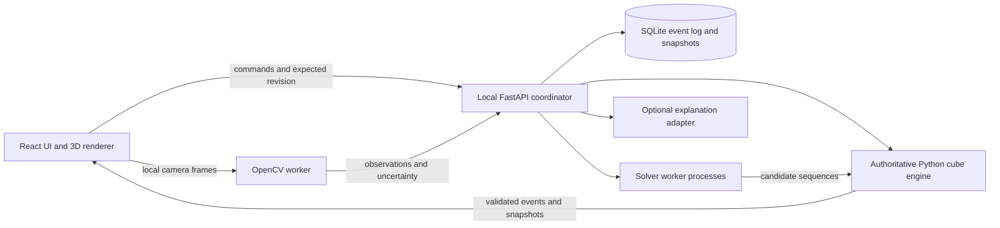

# Proposed architecture

Status: architecture baseline, November 12, 2026. M1A implements the application scaffold; M1B adds the authoritative engine in `backend/src/coach/cube.py`, stateless cube API adapters, and a derived 2D state inspector. The larger directory tree, persistent sessions, solver services, vision, and other interfaces below remain proposed. See the root README and [cube conventions](CUBE_CONVENTIONS.md) for implemented behavior. The single engine module currently uses a 24-way frame string and fixed color identities; expanded notation and configurable color schemes are not yet implemented.

**M1C checkpoint:** the Explorer adds Three.js/React Three Fiber rendering, with engine-provided cubie geometry and per-turn animation plans. A client controller serializes requests and commits verified snapshots with epoch/turn guards; local undo/replay restores saved verified states. This local transient history does not implement the persistent session/event architecture below. See [M1C delivery](MILESTONE_1C.md).

## Runtime and trust boundaries

Build a modular local monolith with two development processes: Vite and FastAPI. FastAPI owns sessions and database writes and launches a small, bounded process pool for CPU-heavy work. A production local build needs only the backend process and its child workers. Avoid a third Node service, Redis, or a distributed job queue initially.



Only the engine determines cube truth. Workers import the same engine package for search and predicate evaluation; their speculative states never replace a live session directly. The coordinator re-verifies returned plans against the requested immutable state. Python move tables and conventions are tested against an independent established library; that library is a development oracle, not a competing live authority.

The renderer interpolates between acknowledged snapshots. Camera orbit is visual only. A notation `x`, `y`, or `z` changes the cube's reference frame through the engine. A failed or disconnected backend freezes cube commands and shows connection state; the browser may retain unsent input, but must not present it as accepted moves. The timer remains independent and marks capture gaps.

## Proposed repository structure

Keep the existing `cubiq/` directory as the application workspace. Introduce backend and feature modules incrementally; do not create empty modules to imply implemented features.

```text
/
├── README.md
├── docs/
│   ├── ARCHITECTURE.md
│   ├── TECHNICAL_DECISIONS.md
│   ├── ROADMAP.md
│   ├── ACCEPTANCE_TESTS.md
│   └── RISKS.md
└── cubiq/
    ├── package.json                  # existing; tooling changes in M1
    ├── package-lock.json             # planned reproducible frontend install
    ├── vite.config.ts
    ├── src/
    │   ├── app/                      # routing, layout, feature availability
    │   ├── components/               # accessible shared controls
    │   ├── features/
    │   │   ├── cube/                 # renderer and notation input
    │   │   ├── coach/                # objectives and verified plans
    │   │   ├── timer/
    │   │   ├── review/               # stage selection and parallel replay
    │   │   ├── history/
    │   │   ├── trainer/
    │   │   └── camera/               # capture, overlays, recovery
    │   ├── api/                      # generated types and event client
    │   └── styles/
    ├── backend/
    │   ├── pyproject.toml
    │   ├── uv.lock
    │   ├── src/coach/
    │   │   ├── main.py
    │   │   ├── api/                  # HTTP, WebSockets, schema, origin checks
    │   │   ├── cube/                 # sole authoritative rules implementation
    │   │   │   ├── state.py          # immutable cubies, frame, serialization
    │   │   │   ├── notation.py       # parser, normalization, inversion
    │   │   │   ├── moves.py
    │   │   │   ├── validation.py
    │   │   │   ├── metrics.py        # versioned HTM rules
    │   │   │   └── predicates.py     # solved and CFOP stage goals
    │   │   ├── sessions/             # commands, revisions, timing, replay
    │   │   ├── solvers/
    │   │   │   ├── contracts.py
    │   │   │   ├── two_phase.py      # established-library adapter
    │   │   │   ├── exact.py          # bounded HTM optimal search
    │   │   │   └── cfop/             # cross, pairs, recognition, OLL, PLL
    │   │   ├── analysis/             # boundaries, alternatives, analytics
    │   │   ├── training/
    │   │   ├── vision/               # calibration, scan, track, confidence
    │   │   ├── explanations/         # deterministic facts, optional AI
    │   │   └── storage/              # repositories and migrations
    │   ├── data/algorithms/           # versioned records and provenance
    │   └── tests/                    # engine, solver, integration tests
    ├── contracts/                   # generated OpenAPI/event schemas
    ├── tests/
    │   ├── fixtures/                # golden states, solves, optical cases
    │   ├── conformance/             # independent-library differential checks
    │   └── e2e/                     # Playwright browser flows
    ├── scripts/                     # local dev and validation entry points
    ├── dist/                        # existing, empty; future build output
    └── .openai/hosting.json          # existing; preserve until hosting work
```

Runtime SQLite, optional recordings, caches, and pruning tables belong in a documented user data directory outside source and build output. Use a temporary directory/database for tests. Node is a build/development requirement, not a local production service.

## Canonical state and notation

`CubeStateV1` contains corner permutation/orientation (8 each), edge permutation/orientation (12 each), a proper rotation frame ID (one of 24), a center-to-color scheme, and a schema version. Canonical cubies use a fixed center frame. Center-relative facelets are a derived 54-sticker `URFDLB` interchange representation, with each face row read from outside that face. M1 must freeze the exact cubie ordering, sticker index diagrams, handedness, and orientation conventions in fixtures before adapters are written.

Validation includes unique cubies, legal color counts and centers, corner twist sum modulo 3, edge flip sum modulo 2, matching corner/edge permutation parity, and a proper center orientation. Equal sticker counts alone are insufficient. Partially scanned facelets are observations, not valid `CubeStateV1` objects. Physically impossible states receive actionable errors and cannot reach a solver.

Keep an orientation-sensitive `stateHash` over deterministic versioned serialization, including frame and color scheme. An optional `positionHash` ignores view frame for search caching. Live session revisions are separate, monotonically increasing identifiers. Solvedness ignores whole-cube orientation; notation interpretation does not.

Support `U D L R F B`, prime and double suffixes, and `x y z`. CFOP reference compatibility also requires `Rw/Lw/...`, lowercase wide aliases such as `r` and `d`, and `M E S`. Normalize typographic apostrophes and `R2'` deliberately; preserve original input. Parentheses group sequences without changing their effect. Reject unsupported syntax with a location; never silently omit tokens. Advanced commutator/repetition syntax can follow later with explicit grammar/versioning.

HTM comparisons use the 18 outer face-turn generators: quarter, inverse quarter, or half turn each costs 1; rotations cost 0. Wide turns and slices are converted to equivalent outer turns plus a tracked frame: a wide turn costs 1 and a slice turn costs 2 in this project's normalized HTM convention. Label this convention; it is not a claim that WCA's Outer Block Turn Metric and every slice-counting convention are identical. Keep execution tokens and rotation count as separate metrics. Solver proofs use only the 18 generators and the stated solved predicate. See [notation decisions](TECHNICAL_DECISIONS.md#td-03--notation-rotations-and-move-counting).

## Command and event flow

An input command includes session ID, unique command ID, expected revision, input source, client monotonic timestamp/clock ID, and notation or a typed operation. The coordinator serializes writes per session, parses the command, applies the engine, and transactionally stores events plus the new snapshot before acknowledgement. Sequence batches are atomic at command level but retain individual move boundaries for replay. Rejected batches change no state.

Each committed event records sequence number, previous/new state hashes, canonical and original token, engine/schema version, event source, clock metadata, server receipt time, and applicable confidence/evidence references. Sources distinguish virtual input, confirmed camera transition, manual correction, imported moves, and resynchronization. Tentative vision hypotheses live outside the committed move stream.

WebSocket deliveries can repeat or be interrupted. Clients deduplicate by session/sequence, resume after their last acknowledged sequence, and request a snapshot if history is unavailable. Duplicate commands are idempotent; stale revisions are rejected, then explicitly rebased or resubmitted. Multiple tabs do not silently interleave solves. Reconnect must not duplicate moves or lose their order.

Proposed API surface, finalized through schemas during implementation:

| Interface | Responsibility |
| --- | --- |
| `GET /api/health`, `/api/capabilities` | Backend status, supported notation, available solver/vision/AI capabilities. |
| `POST /api/states/validate` | Validate/import cubies or oriented facelets; return structured errors. |
| `POST /api/sessions`, `/api/sessions/{id}/commands` | Create session and apply versioned, idempotent commands. |
| `WS /api/sessions/{id}/events` | Committed events, snapshots, timer/vision status, job progress. |
| `POST /api/solver-jobs`, `DELETE /api/solver-jobs/{id}` | Budgeted plan generation and cancellation from immutable states. |
| `GET /api/solver-jobs/{id}` | Verified result, proof status, or explicit failure. |
| `GET /api/solves`, `/api/solves/{id}` | History and exact reconstruction. |
| `POST /api/solves/{id}/alternatives` | Compute comparison branches for selected event ranges/goals. |
| `POST /api/practice`, `GET /api/algorithms` | Verified case setup and versioned algorithm records. |
| `POST /api/vision/sessions`, `WS /api/vision/{id}/frames` | Camera configuration and bounded frame ingestion. |
| `POST /api/explanations` | Optional explanation of an existing verified analysis. |

Pydantic/JSON Schema and OpenAPI define the wire contracts; generate TypeScript DTOs and check schema drift. API/event schema versions and engine versions are explicit. CPU jobs run in killable child processes with memory/time budgets. Cancellation must terminate work rather than just hide a result. Camera frames use a bounded latest-frame queue; drop stale frames, report loss, and preserve command traffic responsiveness.

## Solver services and Next Best Move

Every plan includes input hash/revision/frame, objective, metric/version, engine/solver/algorithm versions, budget and elapsed search time, candidates considered, normalized moves, cost, predicted result hash, validation outcome, and goal predicate. Results distinguish invalid input, queued/running, verified result, timeout without result, cancellation, unavailable dependency, and internal failure.

**Minimum-move:** obtain short candidates through an established two-phase adapter, validate them, then optionally improve/prove with budgeted IDA* using admissible heuristics. Retain the lowest-HTM verified candidate. A proof requires exhaustive exclusion of all lower costs or a verified admissible lower bound equal to the candidate cost. Save completed search bounds, move set, goal, engine/heuristic versions, and proof method. A time-limited search, a known scramble length, or solver brand does not prove optimality. An exact Cross result proves only that Cross objective, not a shortest full solve. Deep arbitrary states have no guaranteed interactive proof time.

**CFOP:** choose a cross color (white by default), map it to logical D, and fix this training frame for stage predicates. Begin with the earliest unsatisfied ordered goal: Cross, all F2L slots, last-layer orientation, solved. Cross is edge-coordinate search; F2L plans inspect current pair/slot configuration and use verified setup/extraction/insertion macros plus bounded goal-directed search. Candidate endpoints preserve the cross and previously completed slots; intermediate turns may temporarily disturb them. OLL/PLL recognize the actual state under U setups and supported frame changes, apply catalog variants, and verify postconditions including final AUF. Detect solved/skipped stages explicitly.

F2L search and catalog coverage are major engineering work. Budget exhaustion returns `no_verified_plan_within_budget` or a validated partial stage plan, clearly labeled; it must never relabel a two-phase sequence as CFOP. General two-phase solving remains a separately selected objective. M4 cannot claim full CFOP readiness until its coverage gate passes.

**Next Best Move:** compute a verified continuation from any legal imported or reconstructed state, without needing scramble history. Minimum-move returns the first move/prefix of the best available validated full plan. CFOP returns a meaningful verified stage/pair sequence with its preconditions and target. Re-check the entire sequence and prefix state predictions. A new move invalidates the displayed recommendation immediately. “Best” means best among searched candidates under the disclosed objective/budget; it does not establish that every faster human alternative has been considered. A solved state returns no move and a solved result.

## Capture, stage analysis, and counterfactual replay

The browser measures solve time from monotonic timestamps, never animation completion or interval tick counts. Keyboard/touch events and virtual move times share a clock domain. Camera timestamps use explicit clock mapping and uncertainty; backend receipt time is not substituted for capture time. Manual timer start/stop remains available. Training pause/resume records paused intervals and excludes them from active duration; speedsolve mode never stops elapsed time for thought pauses. Store both wall duration and active duration and keep paused practice out of ordinary speedsolve averages.

Executed HTM/TPS uses the committed event stream without algebraically cancelling actual turns. Reduced solution HTM is a separate comparison value. TPS is HTM divided by eligible duration; zero-duration or incomplete capture yields unavailable rather than infinity or a fabricated rate. Define an observed inactivity interval using a configurable threshold (initially 500 ms) from the end of one confirmed move to the start of the next. Recognition time, initial delay, explicit timer pauses, and unknown capture intervals are separate. A camera gap is never counted as confirmed thinking time.

Stage goal predicates are nested: correctly aligned four cross edges; cross plus all four F2L corner-edge slots solved; F2L plus last-layer orientation; solved including AUF. Persist exact event indices, state hashes, cross color/frame, annotation origin, and classifier version. Use first attainment of each ordered predicate after the previous boundary as a reproducible initial classifier. Transient later predicate losses do not rewrite earlier boundaries. Show stage labels as inferred: an arbitrary human solve can revisit goals or use a different method. Preserve the predicate timeline and allow user boundary annotations; don't imply recognition or cognitive stages were measured. Zero-move skips have zero move cost, while observed recognition delays can still exist.

For “What Could I Have Done Instead?”:

1. Load the immutable initial state and event log; reconstruct the state immediately before the selected stage/range, including its notation frame. Verify it against the stored boundary hash. Missing history yields an explicit unavailable comparison.
2. Replay the actual event range in one read-only branch. Start each alternative from the identical full state in another engine instance. Neither branch mutates the original solve.
3. Define the comparison goal: same stage postcondition and protected slots, exact actual endpoint, or remaining full solve. Verify each candidate against that goal. Two valid stage solutions can leave different future states; say so.
4. Compare executed and normalized HTM, rotations, achieved goals, and actual measured pauses. Where endpoints differ, optionally solve both continuations under the same budget and label those estimates. Never append the actual later moves to a changed alternative state without revalidation.
5. Synchronize scrubbers by move index or a clearly labeled playback clock. Alternative animation speed is not measured physical execution time. Explain concrete computed differences, not an unsupported number of seconds saved.
6. Practice by restoring the saved state/frame or generating and validating a setup from solved. A virtual practice reset can use the exact state directly. A physical practice setup requires a separately verified setup sequence. Save practice as a new linked session.

## Storage and analytics

SQLite with migrations, foreign keys, WAL, a serialized writer, and bounded busy retry is sufficient for a single local user. Persist sessions/solves, initial states, immutable move events, timer events, state checkpoints, stage annotations, solver runs/proofs, algorithm catalog versions, practice attempts, tracking gaps, and resynchronization records. Derived summaries are recomputable and versioned. Snapshot periodically (initially every 25 events) and at boundaries; verify reconstruction from both initial state and nearest checkpoint. Export includes versions and provenance; import revalidates everything.

Analytics initially include duration trends, best/mean, Ao5/Ao12, HTM, TPS, stage durations, pause distributions, case accuracy, and practice retention. Store result status and +2/DNF separately from raw time. Trimmed Ao5/Ao12 discard one best and one worst result; one DNF can be discarded as worst, two make the average DNF. Show insufficient data instead of a synthetic average. Keep virtual, manual-timer-only, paused practice, fully tracked physical, and gap-containing physical sessions distinguishable. Timer-only solves support time analytics, but not move/stage analytics without a trustworthy move history.

## Vision and recovery

Browser capture sends downscaled timestamped frames only to the local service. Guided scanning asks the user to show all six faces in a controlled orientation without changing the scramble, calibrates colors/lighting from centers, accumulates stable observations, and presents an editable facelet preview. A coherent scan must pass full engine legality checks and user confirmation before creating/replacing a session state. Never fill unseen stickers using a convenient solver state.

Tracking starts from a confirmed full scan and calibrated camera pose. Separate image quality, color classification, pose, visibility, and transition evidence. Test candidate legal transitions against multi-frame evidence, permitting only supported, observable actions. Multiple compatible candidates, stale frames, occlusion, lost pose, or unobservable hidden turns cause abstention. A unique candidate within an artificially restricted model is not automatically sufficient evidence.

Use states `uninitialized → scanning → synchronized → uncertain → resync_required`, with recovery through a confirmed scan or explicit user correction. When uncertain, retain the last confirmed state as a historical checkpoint, freeze physical-state-dependent recommendations/automatic stage capture, keep timer elapsed time running, and append an uncertainty interval. Do not claim the physical cube still matches that checkpoint. A rescan can establish a new valid state but cannot recover an unobserved move sequence. Append a discontinuity and mark affected history incomplete; reconstructed alternatives cannot span that gap. Manual correction is attributed to the user. Do not interpolate hidden turns.

`synchronized` means consistent with accepted evidence within the declared operating conditions, not proof that invisible actions have never occurred. Completely hidden turns can escape detection as well as identification. Label that limitation in the camera view and require deliberate visibility/full-state verification when continuity cannot be supported.

## Explanations, UI, and local operation

Deterministic explanations come first: goal achieved, protected pieces, measured counts, setup moves, and proof status. An optional AI adapter receives only a verified fact bundle with stable fact IDs and computed plans. Initially it selects and orders approved explanation templates and fact references; the application fills factual slots from validated data. Unknown template IDs, extra assertions, new notation, or invented numerical values are rejected. Fact IDs alone cannot validate the meaning of arbitrary generated prose, so unrestricted narrative is deferred. API keys stay server-side, and camera frames/history are not sent externally by default.

Use a dark-first shell with Coach, Review, History, Trainer, and Camera views. Put state validity, active objective, proof status, and tracking status next to the cube. Provide keyboard focus, touch controls, reduced motion, text notation, and a 2D facelet fallback. At narrow widths stack replay panes without losing their common controls. Empty, loading, unavailable, timeout, and capture-gap states must be real UI states, not placeholder success.

Bind local services to loopback, restrict HTTP and WebSocket origins, use a local session token for state-changing endpoints, bound input/frame sizes, and avoid debug routes in the local production build. Camera requires a browser secure context and permission; localhost behavior must be validated in target browsers. Stop camera tracks on exit. Core runtime assets and algorithm data are bundled locally; optional external explanations are separately enabled. See [MDN camera documentation](https://developer.mozilla.org/en-US/docs/Web/API/MediaDevices/getUserMedia), [FastAPI WebSockets](https://fastapi.tiangolo.com/advanced/websockets/), and [OpenCV color conversion APIs](https://docs.opencv.org/4.x/d8/d01/group__imgproc__color__conversions.html) for platform mechanisms, not evidence of working cube recognition.
